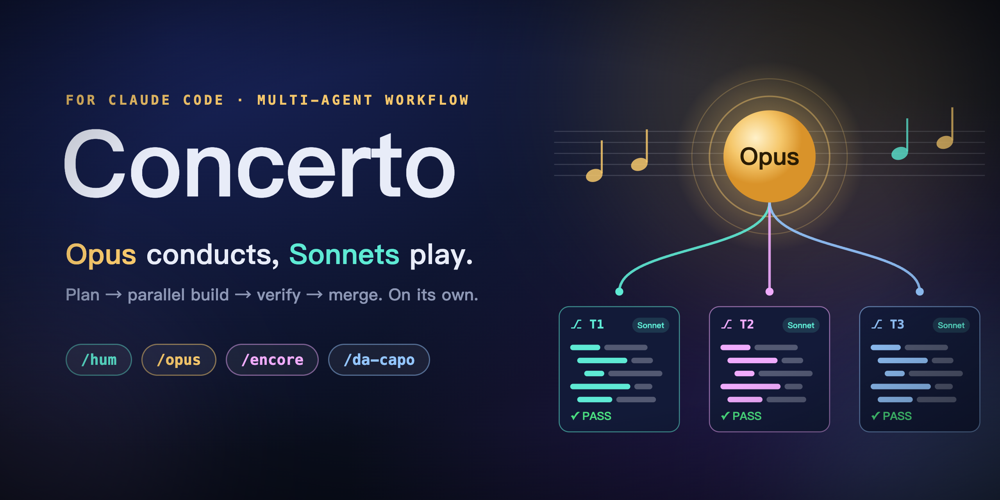

<p align="center"></p>

English · [简体中文](README.zh-CN.md) · [Deutsch](README.de.md)

Concerto turns [Claude Code](https://claude.com/claude-code) into an automatic, parallel coding pipeline. You keep dropping ideas; Opus plans them, several Sonnet agents implement them side by side in isolated git worktrees, an independent verifier checks every result, and everything is merged back — without you babysitting it.

It was built for people whose ideas never stop coming (ADHD-friendly by design): capturing an idea costs one short command, and processing the whole pile costs one more.

```
/hum fix the login timeout          # capture, one line, instant
/hum add --json output to the CLI
/hum split utils into three modules
/opus                               # plan → parallel build → verify → merge, all by itself
```

## How it works

```
        ┌──────────────┐
ideas → │ Opus         │  recon, task cards, dependency graph
        │ (orchestrator)│
        └──────┬───────┘
               │ dispatches every card whose dependencies are met (max 4 at once)
     ┌─────────┼──────────┐
     ▼         ▼          ▼
 executor   executor   executor      Sonnet, one git worktree each
     │         │          │
     ▼         ▼          ▼
 verifier   verifier   verifier      Sonnet, independent, read-only
     └─────────┼──────────┘
               ▼ PASS → merge into concerto/<plan-id>, run tests
        ┌──────────────┐
        │ base branch  │  fast-forward only when everything is green
        └──────────────┘
```

- **Dependency-driven scheduling.** A card starts the moment its dependencies are merged; no waiting for a whole wave. Cards that touch the same files are never run together.
- **Pipelined verification.** Every executor result is verified and merged as soon as it returns. A failed card is retried with the verifier's concrete fix instructions (twice), then Opus takes over.
- **Multi-round.** Ideas you add while a round is running are picked up automatically in the next round, up to 3 rounds in a row, so you can keep capturing from a second terminal.
- **Resumable.** All state lives in `.claude/work/<plan-id>/plan.md` and `log.md`; `/da-capo` resumes after an interruption.
- **Safe by default.** Concerto never pushes and never forces. Work happens on `concerto/<plan-id>` and is merged back only when the tests pass; otherwise it stays there for you to inspect.

## Commands

| Command | What it does |
|---|---|
| `/opus <requirements>` | Plan and execute one or more requirements (`;`-separated) end to end. |
| `/opus` | With no arguments: take **every pending idea** from the pool, group them, run independent ones in parallel. |
| `/hum <idea>` | Append an idea to `.claude/work/ideas.md`. One line, no analysis. |
| `/hum` | Group pending ideas and suggest `/opus` commands. |
| `/encore` | Dashboard of all plans in the project (progress, failed or blocked cards) and pending ideas. Read-only. |
| `/da-capo [plan-id]` | Resume or re-run a plan (default: the latest unfinished one). Also use it after hand-editing `plan.md`. |

A `SessionStart` hook also reminds you about unfinished plans and pending ideas whenever you open a session in a project.

## Install

Requirements: [Claude Code](https://claude.com/claude-code), `git`, `jq`, macOS or Linux (bash).

```bash
git clone https://github.com/ClarkeLi/concerto.git
cd concerto
./install.sh
```

The installer copies two agents, four skills, a hook script and a plan template into `~/.claude/` (set `CLAUDE_HOME` to use another location), appends a short block to `~/.claude/CLAUDE.md`, and appends one `SessionStart` hook to `~/.claude/settings.json` after backing it up to `settings.json.bak-concerto`. It never overwrites your existing settings, and re-running it is safe; any file it replaces is first saved as `*.bak-concerto`.

Remove it with `./uninstall.sh` (your project data in `.claude/work/` and the backups are left alone).

Run `/opus` in an **Opus** session for the best planning quality; the executors and verifiers always use Sonnet.

## Project data

Per project, created on demand and added to `.git/info/exclude` so it is never committed:

```
.claude/work/
├── ideas.md              # the idea pool: "- [ ] 2026-10-28 <idea>"
└── <plan-id>/            # YYYYMMDD-HHMM-short-slug
    ├── plan.md           # task cards + state: the single source of truth
    └── log.md            # dispatch / verification / merge log
```

The idea pool is per project. An idea recorded while you are in project A is not visible from project B.

## Good to know

- Trivial work (one file, under ~30 lines) skips the pipeline; Opus just does it.
- Opus only stops to ask when a wrong guess is costly (data loss, public API change, irreversible migration), when it needs a secret or paid resource, or when the request fundamentally conflicts with the architecture.
- If the directory is not a git repository, Concerto runs `git init` (never in `$HOME` or `/`) and makes an initial snapshot commit.
- Uncommitted changes are auto-stashed before a run and restored afterwards.
- Subagent worktrees are created from the default branch, so each executor first merges `concerto/<plan-id>` to pick up earlier results.
- Concerto relies on Claude Code features (skills, subagents with `isolation: worktree`, hooks) that evolve quickly. If something stops working after an update, please open an issue.

## Why "Concerto"?

A concerto is a soloist performing with an orchestra. Opus is the soloist, the Sonnets are the orchestra, and the commands are the score: `hum` a theme, play the whole `opus`, call an `encore`, or go back to the beginning, *da capo*.

## License

MIT
